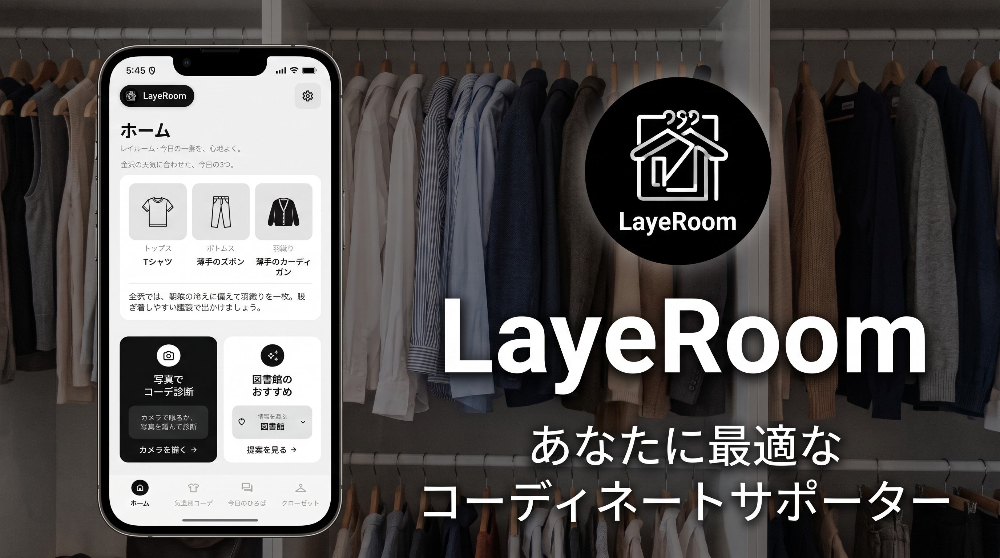
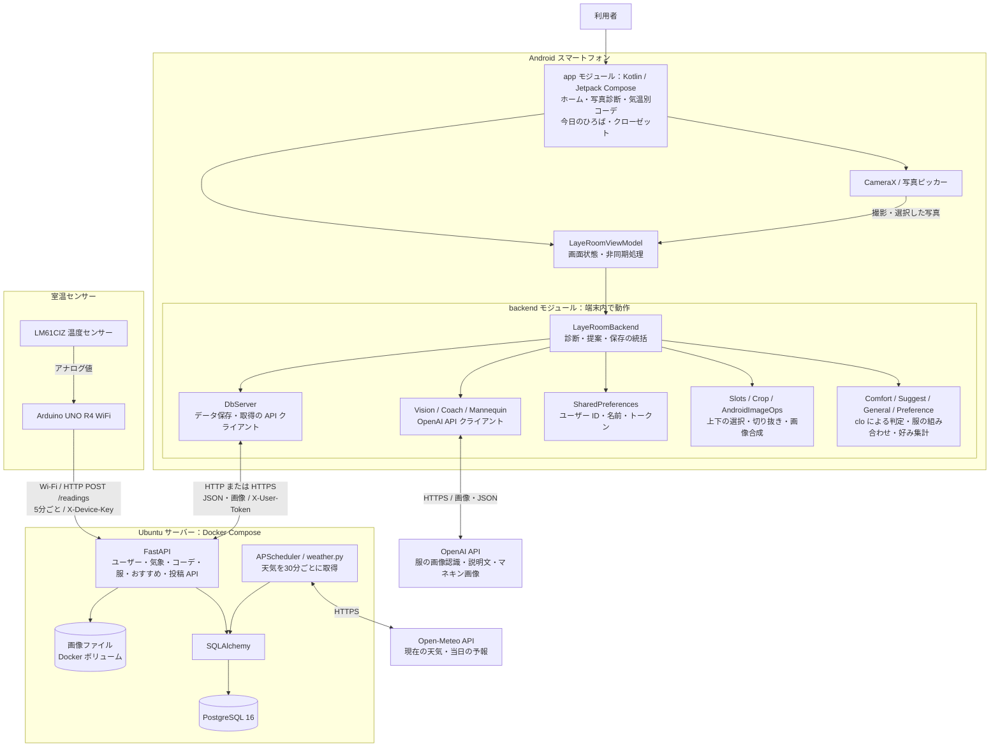
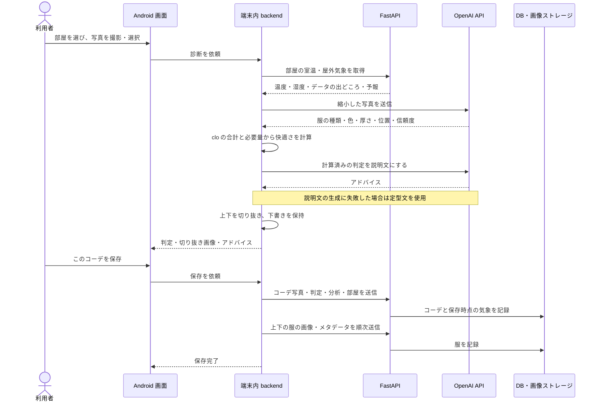

# LayeRoom（レイルーム）

**今日の一着を、心地よく。** — 講義室の室温と外の天気から、「その部屋」で心地よく過ごせる服を提案する Android アプリ

<p align="center">
  
</p>

## 目次

- [発表資料](#発表資料)
- [製品概要](#製品概要)
- [開発技術](#開発技術)
- [リポジトリ構成](#リポジトリ構成)
- [システム構成図](#システム構成図)
- [各部分の役割](#各部分の役割)
- [写真診断から保存まで](#写真診断から保存まで)

---

## 発表資料

[JPHACKプレゼンテーション（PowerPoint）](docs/slides/JPHACKプレゼンテーション_最終版.pptx?raw=true)

発表で使用したスライドをダウンロードできます。

## 製品概要
### 背景(製品開発のきっかけ、課題等）
天気予報を見て服を決めても、講義室に入ると暑すぎたり寒すぎたりする。
外は肌寒いのに教室は暖房で暑い、図書館だけ冷える、など、**室内と屋外の温度差**のせいで服選びを外してしまうことがよくある。
天気予報は「外」の情報しか教えてくれず、「これから過ごす部屋」に合う服装は自分の勘に頼るしかない、というのが出発点。

### 製品説明（具体的な製品の説明）
LayeRoom は、**講義室に置いた温度センサーの実測値**と**金沢の天気**を組み合わせて、服装を判定・提案するアプリ。

- **ホーム**
**写真でコーデ診断**：今日の服を撮ると、AI が写っている服の種類を読み取り、選んだ部屋の室温に対して「ちょうどいい / 上着を脱げばちょうどいい / 暑い / 寒い」を判定する。
https://github.com/user-attachments/assets/bb9ee2d0-15d7-44e4-9b2c-bf0735270371

    **自分の服から提案**：診断した写真から上下の服を切り出して自動でクローゼットに登録し、その日の部屋と天気に合う組み合わせをAIが自動で提案する。提案はマネキンが着た画像として表示する。
https://github.com/user-attachments/assets/76d40b3a-9785-4dbe-bc11-6fa66b9df4b9

- **今日のひろば**：各ユーザーが部屋ごとに「快適・少し寒い」などの体感やコメントを投稿・共有できる。先にその部屋にいる人の声を見てから服を選べる。
https://github.com/user-attachments/assets/187f05d6-cf72-4388-89a0-e514e3705ada

- **気温別コーデ**：過去に保存したコーデを、その日の気温・室温で振り返れる。
- **クローゼット**: 過去に保存した服を、「トップス・ボトムス」など種類別に分けて閲覧することが出来る。
https://github.com/user-attachments/assets/7b5d04c7-f6ed-4bd9-96a9-7a97edd0bb4c

### 特長
#### 1. 「部屋」単位で室温を考える
講義室に置いた Arduino の温度センサーが5分ごとに室温を送り、外の天気（Open-Meteo）と合わせて保存する。
判定・提案は「どの部屋で過ごすか」を選んで行い、その部屋の室温と屋外との差を使う。

#### 2. 写真1枚で、判定からクローゼット登録まで
AI が写真から服を読み取り、服ごとの暖かさ（clo 値）を足し合わせて「今の服の暖かさ」と「その室温で必要な暖かさ」を比べて判定する。
保存すると上下の服を切り出して自動で登録するので、服を1着ずつ手で登録する必要がない。

#### 3. 着た姿で見られる提案と、みんなの体感
提案した上下の服を、AI がマネキンに着せた画像にして見せる。
今日のひろばでは、同じ部屋にいる人の体感の投稿と件数が見られる。

### 解決出来ること
- 室内外の温度差による「服装の失敗」を減らす（暑くて我慢する・寒くて集中できない）
- 「上着を脱げばちょうどいい」まで分かるので、着ていくべきか・持っていくべきかを判断できる
- 部屋ごとの体感が共有されるので、行ったことのない教室・久しぶりの場所でも服を選びやすい

### 今後の展望
<!-- TODO: チームで決めた内容に合わせて調整する -->
- 湿度センサーを追加して、室内の不快指数を実測で判定する（今は温度のみ実測）
- センサーを複数の教室に置き、すべての部屋を実測値にする（今は1部屋のみ実測・ほかは仮の値）
- スケジュールや時間割と連携し、朝の通知で、その日の時間割の部屋に合わせた服を提案する
- OpenAI のキーを端末に置かない中継サーバー構成にして、一般に配布できるようにする
- 現在は上下のアイテムでしか区別していないので、アウターやインナー、帽子、靴、カバンなど、多種多様なアイテムを判定し、コーデをより詳細に提案してくれるようにする

### 注力したこと（こだわり等）
* **AI に丸投げしない判定**：写真から服を読み取るのは AI、暑い・寒いの判定は着衣量（clo）と室温からの計算にして、結果の理由を説明できるようにした
* **室内の値の出どころを明示**：センサーの実測・仮の値・外の湿度での代用を区別して保存・表示し、仮の値で誤った判定をしないようにした


## 開発技術
### 活用した技術
#### API・データ
* OpenAI API（写真からの服の読み取り・アドバイス文の生成・マネキンの着用画像の生成）
* Open-Meteo（金沢の現在の天気と今日の予報。APIキー不要）
* 自作の DB サーバー API（FastAPI・センサー値・天気・コーデ・服・おすすめ・ひろばの投稿）

#### フレームワーク・ライブラリ・モジュール
* Android：Kotlin
* サーバー：Python / FastAPI / SQLAlchemy / APScheduler / Docker Compose

#### デバイス
* Android スマートフォン
* Arduino UNO R4 WiFi ＋ 温度センサー LM61CIZ
* Ubuntu 24.04 サーバー

### 独自技術
#### ハッカソンで開発した独自機能・技術
* **着衣量（clo）による暑い・寒いの判定**：[`Layeroom_app/backend/.../ai/Comfort.kt`](Layeroom_app/backend/src/main/java/jp/climafit/backend/ai/Comfort.kt)
* **提案コーデのマネキン着用画像**：[`Layeroom_app/backend/.../ai/Mannequin.kt`](Layeroom_app/backend/src/main/java/jp/climafit/backend/ai/Mannequin.kt)
* **部屋ごとの室内の値（センサーの部屋は実測・ほかは仮の値）**：[`db_server/api/app/indoor.py`](db_server/api/app/indoor.py)
* **今日のひろば（部屋ごとの体感の投稿と集計）**：[`db_server/api/app/routers/plaza.py`](db_server/api/app/routers/plaza.py)
* **室温センサーの送信**：[`arduino/sensor_sender/sensor_sender.ino`](arduino/sensor_sender/sensor_sender.ino)
* 初回起動時のユーザー登録の必須化：commit `ea4c4bf`

## リポジトリ構成

| フォルダ | 内容 | 詳しい説明 |
|---|---|---|
| [`Layeroom_app/`](Layeroom_app) | Android アプリ（画面 `app/` と、端末内のバックエンド `backend/`） | [Layeroom_app/README.md](Layeroom_app/README.md) |
| [`db_server/`](db_server) | DB サーバー（FastAPI ＋ PostgreSQL、Docker Compose） | [db_server/README.md](db_server/README.md) |
| [`arduino/`](arduino) | 室温センサーのスケッチ（Arduino UNO R4 WiFi） | [arduino/README.md](arduino/README.md) |


## システム構成図



## 各部分の役割

| 部分 | 主な役割 | 技術 |
|---|---|---|
| Android 画面 | 撮影、診断結果表示、履歴検索、体感投稿、クローゼット操作 | Kotlin、Jetpack Compose、CameraX |
| 端末内 backend | 写真解析の依頼、快適さ判定、服の選択、画像処理、API 通信 | Kotlin、Coroutines、Ktor、Bitmap |
| DB サーバー | 認証、センサー値・天気・コーデ・服・おすすめ・投稿の保存と取得 | Python、FastAPI、SQLAlchemy |
| データベース | 画像以外のデータと画像の保存パスを保持 | PostgreSQL 16 |
| 画像ストレージ | コーデ写真と上下の服の切り抜き画像を保持 | ファイルシステム、Docker ボリューム |
| 室温センサー | 温度を測定し、5分ごとに送信 | Arduino UNO R4 WiFi、LM61CIZ |
| OpenAI | 服の種類・色・厚さ・位置の認識、説明文・着用画像生成 | Chat Completions、Images API |
| Open-Meteo | 現在の気象と当日の予報を提供 | 天気 API |

## 写真診断から保存まで


```
Arduino（室温） ──▶ DB サーバー ◀── 天気（Open-Meteo）
                       ▲
Android アプリ ────────┘   写真の読み取り・提案の画像は OpenAI
```

<!-- TODO: チームメンバーと担当を書く -->
